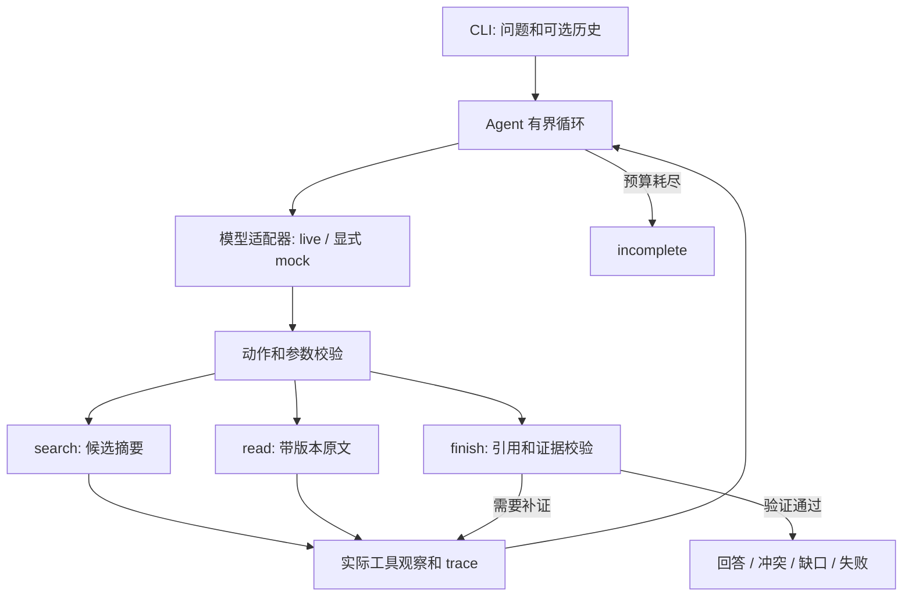

# 02 方案与动态决策

## 组件和执行链

- `models.py`：统一 decide(messages, tools) 接口。live 通过兼容 Chat Completions 的 HTTP 请求获得动作；Mock 根据工具观察选择动作，用于可重复测试。
- `runtime.py`：构建上下文、验证动作、执行只读工具、记录实际观察、把观察送回模型，并限制总步数。
- `retrieval.py`：版本化文档加载、关键词与中文同义词检索、原文读取；工具故障以结构化结果返回。
- `cli.py`：参数与路径边界、环境配置、JSON 输出与退出码。

循环骨架只负责调度和边界。live 模式没有预先决定完整动作路径，必须等待每轮外部模型返回下一动作。搜索无结果、读取冲突、工具报错会产生不同 observation，进入下一次模型调用。

## 输入、输出和状态
输入问题是字符串；可选历史是 `[{"role":"user"|"assistant","content":"..."}]`。历史只用于理解问题，不能替代原文。知识库每份文档有 doc_id、version_date、title、content、topic 和可选 facts 标注。

返回 question、status、answer、citations、gaps、trace、model_mode。引用包括文档 ID、版本日期与逐字片段。状态见 README。每条 trace 包含实际 step、action、arguments、observation、reason；reason 是短依据，而非内部思维过程。

## 证据与冲突策略
1. 搜索只建立候选列表；成功读取后才进入可引用证据集合。
2. 引用必须匹配本轮文档 ID、版本及原文子串；不允许伪造来源或只引用摘要。
3. 最终有答案时采用保守抽取式输出，返回验证过的原文，不保留模型随意添加的政策结论。这解决“引用真实但回答编造”，代价是自然语言润色能力有限。
4. 同主题证据互斥时，模型应继续查找适用范围或优先级。未找到时列双方引用和缺口，不能按日期或更严格的天数自行裁决。
5. 人工 facts 标注只是合成资料的辅助信号；quote 不再出现在 content 中或 value 不受 quote 支持时不能沿用。重新载入替换后的语料，禁止凭旧答案返回。

工具和文档内容是非可信数据。系统指令与用户问题、历史、观察分开传递；工具只有 search/read，模型不能执行任意代码或任意路径读写。

## 有界失败
总决策步数默认 8，finish 校验失败也消耗步数。工具故障有 code/retryable，后续重试由模型选择；模型传输或解析失败不能悄悄降级到 Mock。用尽预算或无法验证时输出未完成和缺口。

## 检索取舍
有限合成语料使用关键词、中文同义词与主题相关性信号，避免配置嵌入模型或外部向量服务。改写评估应同时保存原始词面基线和当前方案结果；小样本提升只证明当前合成数据，不推断真实企业召回率。

## 为什么不是完整大厂框架
题目明确框架名称不加分，要求可运行、可解释、可验证。当前按 Agent/Model/Tool/Context 职责划分，以标准库实现必要内核。阿里、百度、字节的公开设计依据和选择范围见 [07-architecture-research.md](07-architecture-research.md)。未安装第三方 Agent 框架，因此没有需要声明的框架依赖版本。

## 补充边界：相关性与标注
对“年假一年有几天”和“报销额度上限”这两类明确的合成领域事实维度，系统还会检查是否有对应的有效事实，避免把申请提前期或报销期限作为答案。该规则不是通用语义蕴含模型；未覆盖的问法和复杂上下文仍需要真实模型评估与人工审阅。

同主题多份资料中缺少可比较的事实标注时，离线模式保守追问；相关正文变化导致旧标注失效时也不据此推断一致。即便存在真实原文摘录，也不能宣称系统具备任意文档自动冲突消解能力。未提供适用范围和优先级时维持冲突，明确的废止或适用关系属于后续扩展。

真实适配器使用 HTTP tools/function schema 接收下一动作。运行器将执行过的动作和观察序列化为后续消息传回；协议测试替换本地 HTTP opener，验证请求构造与观察回传，没有调用厂商端点。

## 真实模型多动作响应兼容

DeepSeek真实评测发现，一次响应可能包含多个只读工具提议。适配器会先验证每个提议的函数与参数；只有全部为合法search/read时，按模型顺序执行首个，其余不执行也不排队。Trace的reason明确记录该适配行为。下一轮仍发送新工具观察并重新调用模型，所以不会在工具失败或证据变化后盲目执行旧计划。包含finish、未知工具或畸形参数的多动作响应仍拒绝。执行器每步最多执行一个工具，预算保持不变。
