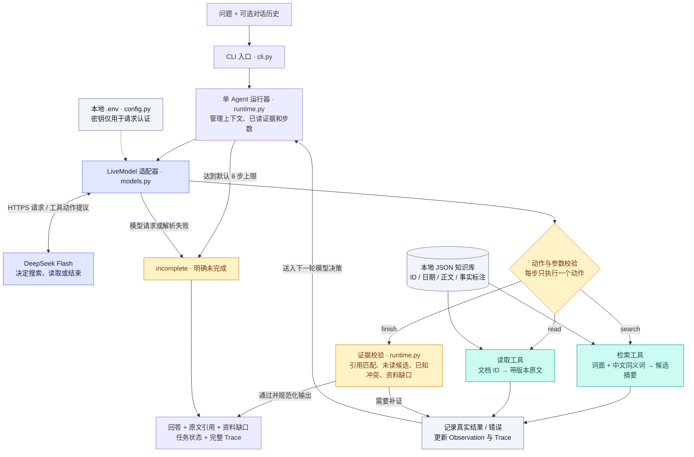

# 当前 Agent 架构

当前产品采用 **单 Agent 的有界 ReAct 式循环 + 本地知识检索 + 证据校验**，由Python标准库原生实现。下图展示已完成真实评测的live路径。

## 各部分的职责

| 组件 | 当前实现与职责 |
|---|---|
| 入口 | `src/kb_agent/cli.py` 接收问题、可选历史、运行模式和预算，输出JSON |
| 决策循环 | `src/kb_agent/runtime.py` 调用模型、执行动作、管理当前请求的状态，默认最多8轮（可配置1–50） |
| 大模型 | `deepseek-flash` 非思考模式，根据上下文与最新观察选择search/read/finish及参数 |
| 请求适配 | `src/kb_agent/models.py` 构造HTTP请求；多个合法只读提议只执行首个，其余不排队，下一轮根据新观察重新决策 |
| 配置 | `src/kb_agent/config.py` 仅在live模式读取项目内.env，环境变量可覆盖；密钥不放入模型消息或Trace |
| 工具 | `src/kb_agent/retrieval.py` 提供search与read，前者发现候选，后者取得可引用原文 |
| 知识库 | `data/knowledge.json` 保存合成资料及版本/事实标注；检索使用词面与同义词，当前没有向量数据库或嵌入模型 |
| 输出校验 | 引用必须来自本轮读取；检查ID、版本、原文片段、已发现同主题候选与已知事实冲突，最终答案用核验原文规范化生成 |
| 评测 | `scripts/evaluate.py` 运行独立场景并保存实际输出/Trace、模型配置和源码hash；单元测试不在每次问答请求中运行 |

## 循环如何工作

每一轮：运行器把问题、历史和已有观察发送给模型 → 模型选择动作 → 代码校验并执行 → 把实际结果或校验错误加入上下文 → 模型重新决定下一步。

真实冲突案例中，模型读取30天/15天两份制度后曾提前选择结束，证据校验返回“需补充检索”，模型接收反馈后继续搜索，最终以conflict状态披露双方引用。完整实际过程见 [真实评测报告](10-live-evaluation.md)。

## 当前边界

- 运行时使用单Agent。此前多个开发/测试/审查agent属于项目开发团队，承担协作分工。
- MockModel是模型接口的离线替身，用于流程回归；选择mock模式不会读取密钥或请求DeepSeek。
- 上下文与证据保存在本次调用的内存中；跨轮用户对话需通过history传入，当前没有独立长期记忆服务。
- 事实标注和问题维度保护适用于合成领域；原文子串校验不等于任意文档的语义证明。
- 只有search/read是知识工具；finish是结束请求，需经过证据校验。工具失败和校验失败进入观察，模型可调整；无效动作、模型故障和预算耗尽会明确未完成。

可编辑图源：[architecture.mmd](architecture.mmd)。新增架构说明不改变运行代码或既有评测结果。
